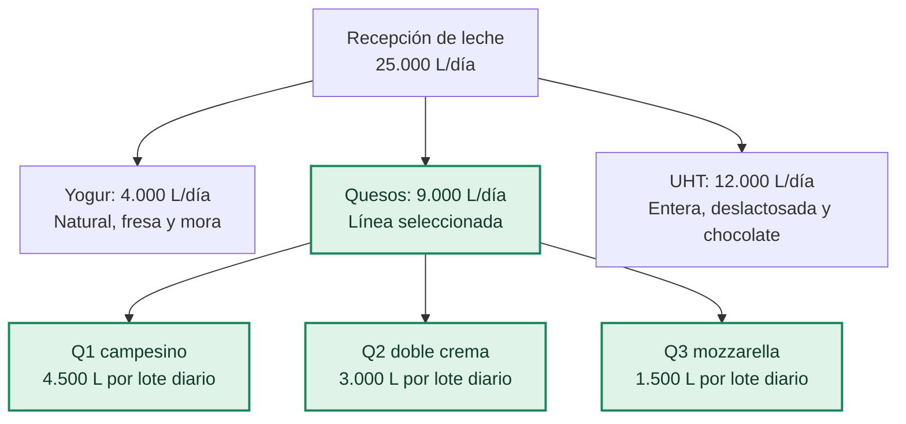

# IntegraMotion · Soluciones industriales 5.0

## 1. Descripción general

IntegraMotion propone una solución de automatización y transformación digital para la planta de Lácteos Fúquene S.A.S., ubicada en Ubaté. La planta considera una alimentación de **25.000 L de leche por día**, distribuida entre yogur, quesos y productos UHT, con tres referencias por línea.

El desarrollo detallado de recetas, control y gemelo digital se concentra en la **línea de quesos: campesino, doble crema y mozzarella**. ISA-88 estructura sus equipos, secuencias y recetas. ISA-95 organiza la integración entre proceso, control, supervisión, gestión de operaciones y gestión empresarial, con una visión de las tres líneas y sus recursos compartidos.

La propuesta vincula órdenes, lotes, materiales, condiciones de fabricación y resultados de calidad mediante una arquitectura OT/IT. Las cantidades, capacidades y parámetros de este documento corresponden al **escenario de diseño**; los resultados de ejecución se registran por separado.

## 2. Objetivos de Transformación Digital Industrial

### Objetivo general

Diseñar la arquitectura de automatización e información de la planta, aplicando ISA-88 a la línea de quesos e ISA-95 a la integración entre operación y gestión.

### Objetivos específicos

- Caracterizar las tres líneas, sus referencias y recursos compartidos.
- Estructurar la celda de quesos, unidades, módulos de equipo y módulos de control.
- Definir recetas, cantidades por lote, secuencias y condiciones de ejecución.
- Identificar sensores, actuadores, variables críticas y confirmaciones manuales.
- Asignar responsabilidades a control, SCADA, funciones MES y ERP.
- Definir interfaces y registros de órdenes, consumos, calidad y trazabilidad.
- Establecer una base común de equipos, estaciones y parámetros para control y gemelo digital de quesos.

## 3. Planta, productos y selección de línea

| Línea | Referencias y presentación | Leche asignada por día | Participación |
|---|---|---:|---:|
| Yogur | Natural azucarado, fresa y mora. Vasos de 150 g. | 4.000 L | 16 % |
| **Quesos** | **Q1 campesino y Q2 doble crema, 500 g; Q3 mozzarella, 2,5 kg.** | **9.000 L** | **36 %** |
| UHT | Entera y deslactosada, 1 L; chocolate, 200 mL. | 12.000 L | 48 % |
| **Total** | **Tres líneas y nueve referencias.** | **25.000 L** | **100 %** |



### Justificación técnica de quesos

La selección se sustenta en rutas diferenciadas y recursos compartidos. Campesino requiere lavado, prensado y oreo; doble crema y mozzarella requieren acidificación de cuajada e hilado, con ingredientes y acondicionamiento diferentes.

El VSM identifica el hilado compartido como recurso limitante del escenario inicial. Para aproximadamente 552 kg/día, una tasa de 70 kg/h requiere 7,89 h de proceso; con 30 min de limpieza, 8,39 h frente a una ventana de 7,4 h. La propuesta considera 300 kg/h, equivalentes a 1,84 h de proceso más limpieza. Son **estimaciones del recurso**, no resultados de desempeño de toda la línea.

Esta línea permite relacionar la selección de recetas con la reserva de equipos, las condiciones de proceso y la trazabilidad de producto y suero.

## 4. Distribución y flujo de proceso

La distribución de diseño considera **67 × 30 m**, 22 estaciones y aproximadamente 192,9 m² de huellas de equipos. Las dimensiones de equipos constituyen la base de implantación. El siguiente diagrama representa conexiones funcionales, sin escala geométrica.

```mermaid
flowchart LR
    subgraph AB["Zona A–B · Leche"]
        E01["E01 Recepción y filtro"]
        E02["E02 Silos 1 y 2"]
        E03["E03 Descremadora y remezcla"]
        E04["E04 Pasteurizador HTST"]
        E01 --> E02 --> E03 --> E04
    end
    subgraph C["Zona C · Tinas"]
        E05["E05 Tina 1 · Q1"]
        E06["E06 Tina 2 · Q2"]
        E07["E07 Tina 3 · Q3"]
    end
    subgraph D["Zona D · Formado"]
        E08["E08 Salado en masa"]
        E09["E09 Moldeo y prensa"]
        E10["E10 Oreo y desmolde"]
        E11["E11 Acidificación Q2"]
        E12["E12 Acidificación Q3"]
        E13["E13 Hiladora-moldeadora"]
        E14["E14 Enfriamiento Q2"]
        E15["E15 Agua y salmuera Q3"]
    end
    subgraph E["Zona E · Empaque"]
        E16["E16 Termoformadora Q1/Q2"]
        E17["E17 Empacadora y túnel Q3"]
        E18["E18 Codificación, peso y metales"]
    end
    subgraph F["Zona F · Despacho"]
