# IntegraMotion · Soluciones industriales 5.0

**Ingeniería y automatización**

Proyecto integrador de Automatización de Procesos de Manufactura.

**Empresa integradora:** IntegraMotion  
**Cliente:** Lácteos Fúquene S.A.S.  
**Ubicación de la planta:** Ubaté, Colombia.

## Equipo de trabajo

| Integrante | Cargo | Responsabilidad |
|---|---|---|
| Santiago Ospina | CEO | Identidad empresarial y transformación digital. |
| Marco Morales | CTO | Transformación digital, modelos ISA-88 e ISA-95 y edición. |
| Dixon Cuesta | CFO | Gestión, administración y finanzas |
| Yesid Ojeda | COO | Simulación en Tecnomatix y diseño del layout. |
| Juan Andres Moreno | CDO | Identidad empresarial y transformación digital. |
| Carlos Guzmán | CCO | EDT del proyecto y estructuración de la información. |

---

## 1. Descripción general

IntegraMotion propone una solución de automatización y transformación digital para la planta de Lácteos Fúquene S.A.S., ubicada en Ubaté. La planta considera una alimentación de **25.000 L de leche por día**, distribuida entre yogur, quesos y productos UHT, con tres referencias por línea.

El desarrollo detallado de recetas, control y gemelo digital se concentra en la **línea de quesos: campesino, doble crema y mozzarella**. ISA-88 estructura sus equipos, secuencias y recetas. ISA-95 organiza la integración entre proceso, control, supervisión, gestión de operaciones y gestión empresarial, con una visión de las tres líneas y sus recursos compartidos.

La propuesta vincula órdenes, lotes, materiales, condiciones de fabricación y resultados de calidad mediante una arquitectura OT/IT. Las cantidades, capacidades y parámetros de este documento corresponden al **escenario de diseño**; los resultados de ejecución se registran por separado.


## 2. Objetivos de Transformación Digital Industrial

### Objetivo general

Diseñar la arquitectura de automatización e información de la planta, aplicando ISA-88 a la línea de quesos e ISA-95 a la integración entre operación y gestión.

### Objetivos específicos

- Caracterizar las tres líneas, sus referencias y recursos compartidos.
- Estructurar la celda de quesos, unidades, módulos de equipo y módulos de control.
- Definir recetas, cantidades por lote, secuencias y condiciones de ejecución.
- Identificar sensores, actuadores, variables críticas y confirmaciones manuales.
- Asignar responsabilidades a control, SCADA, funciones MES y ERP.
- Definir interfaces y registros de órdenes, consumos, calidad y trazabilidad.
- Establecer una base común de equipos, estaciones y parámetros para control y gemelo digital de quesos.

## 3. EDT del Proyecto

  ### Objetivo general
La EDT organiza el proyecto en entregables y paquetes de trabajo. Su alcance comprende desde la planeación inicial hasta la integración y validación de la solución propuesta. Estos objetivos se realizan de forma parcialmente paralela, en un periodo de 16 semanas.

```mermaid
flowchart TD
    P["Consultora de Ingeniería IntegraMotion<br/>25.000 L/día"]

    P --> A["1. Gestión<br/>del proyecto"]
    P --> B["2. Ingeniería<br/>de proceso"]
    P --> C["3. Automatización<br/>y control"]
    P --> D["4. Robótica<br/>y simulación"]
    P --> E["5. MES<br/>y ERP"]
    P --> F["6. Finanzas<br/>y oferta"]

    A --> A1["1.1 Inicio<br/>y planeación"]
    A --> A2["1.2 Seguimiento<br/>y compuertas"]
    A --> A3["1.3 Informe final<br/>y sustentación"]

    B --> B1["2.1 Análisis<br/>del problema"]
    B --> B2["2.2 EDT de la<br/>producción"]
    B --> B3["2.3 VSM de<br/>las líneas"]
    B --> B4["2.4 Medidas<br/>organizacionales"]
    B --> B5["2.5 Arquitectura<br/>ISA-95"]

    C --> C1["3.1 Instrumentación"]
    C --> C2["3.2 PLC<br/>e ISA-88"]
    C --> C3["3.3 SCADA"]

    D --> D1["4.1 Plant Simulation"]
    D --> D2["4.2 RobotStudio"]
    D --> D3["4.3 NX MCD"]

    E --> E1["5.1 Implementación<br/>MES"]
    E --> E2["5.2 Implementación<br/>ERP"]
    E --> E3["5.3 Integración<br/>y comunicación"]

    F --> F1["6.1 Modelo financiero<br/>y oferta"]
    F --> F2["6.2 Financiación"]

    classDef principal fill:#08045f,stroke:#08045f,color:#ffffff,stroke-width:2px;
    classDef nivelUno fill:#eeeeff,stroke:#6666cc,color:#17172f,stroke-width:1px;
    classDef paquete fill:#ffffff,stroke:#7777cc,color:#202020,stroke-width:1px;

    class P principal;
    class A,B,C,D,E,F nivelUno;
    class A1,A2,A3,B1,B2,B3,B4,B5,C1,C2,C3,D1,D2,D3,E1,E2,E3,F1,F2 paquete;
```

### 3.1 Desglose de tiempos
A continuación se presentan los tiempos estimados para cada etapa del proyecto:

#### Gestión del proyecto
| Código | Actividad | Duración | Objetivo |
|---|---|---:|---|
| 1.1 | Inicio y planeación | 2 semanas | Definir y aprobar el alcance, los requisitos, las responsabilidades y la EDT inicial del proyecto. |
| 1.2 | Seguimiento y compuertas | 16 semanas | Controlar el avance, los riesgos, los cambios y las decisiones mediante reuniones periódicas y revisiones de los hitos. |
| 1.3 | Informe final y sustentación | 2 semanas | Integrar los resultados de todos los frentes, preparar los anexos y presentar la sustentación final de la consultoría. |

#### Ingeniería de proceso
| Código | Actividad | Duración | Objetivo |
|---|---|---:|---|
| 2.1 | Análisis del problema | 2 semanas | Diagnosticar la situación actual de la planta e identificar la demanda, las capacidades, las restricciones y los criterios de diseño. |
| 2.2 | EDT de la producción | 3 semanas | Desglosar el proceso productivo en operaciones, equipos, recetas, secuencias y parámetros controlables. |
| 2.3 | VSM de las líneas | 3 semanas | Analizar los flujos de materiales e información para identificar desperdicios, tiempos de espera y oportunidades de mejora. |
| 2.4 | Medidas organizacionales | 2 semanas | Definir los roles, los turnos, las competencias y los procedimientos necesarios para implementar las mejoras propuestas. |
| 2.5 | Arquitectura ISA-95 | 3 semanas | Diseñar la arquitectura y los flujos de información entre los niveles operativos y los sistemas empresariales. |

#### Automatización y control
| Código | Actividad | Duración | Objetivo |
|---|---|---:|---|
| 3.1 | Instrumentación | 3 semanas | Seleccionar y especificar los instrumentos, sensores y actuadores requeridos para medir y controlar las variables del proceso. |
| 3.2 | PLC e ISA-88 | 4 semanas | Diseñar la lógica de control, las secuencias, las fases, los módulos y los interbloqueos de seguridad del proceso. |
| 3.3 | SCADA | 3 semanas | Diseñar las pantallas de supervisión, alarmas, tendencias e indicadores para monitorear y operar el proceso. |

#### Robótica y simulación
| Código | Actividad | Duración | Objetivo |
|---|---|---:|---|
| 4.1 | Plant Simulation | 4 semanas | Construir un modelo de eventos discretos que permita evaluar la capacidad, las rutas, los turnos, las fallas y diferentes escenarios productivos. |
| 4.2 | RobotStudio | 3 semanas | Diseñar y validar virtualmente una celda robotizada, considerando el alcance del robot, los patrones de estiba, el efector final y la seguridad. |
| 4.3 | NX MCD | 4 semanas | Crear un gemelo virtual mecatrónico para validar la cinemática, las señales, las secuencias y la interacción con un PLC virtual. |

#### MES y ERP

| Código | Actividad | Duración | Objetivo |
|---|---|---:|---|
| 5.1 | Implementación MES | 4 semanas | Diseñar el modelo MES para gestionar órdenes, recetas, lotes, trazabilidad e indicadores de producción. |
| 5.2 | Implementación ERP | 4 semanas | Definir la configuración funcional del ERP para integrar compras, inventarios, costos y ventas. |
| 5.3 | Integración y comunicación | 2 semanas | Diseñar y probar las interfaces de comunicación entre MES, ERP y SCADA. |

#### Finanzas y oferta

| Código | Actividad | Duración | Objetivo |
|---|---|---:|---|
| 6.1 | Modelo financiero y oferta | 12 semanas intermitentes | Evaluar la viabilidad económica del proyecto y construir el caso de negocio, el flujo de caja y el precio de la oferta. |
| 6.2 | Financiación | 3 semanas | Definir una estructura de financiación basada en los hitos de pago, el flujo de caja y alternativas como crédito o leasing. |


## 4. Planta, productos y selección de línea

| Línea | Referencias y presentación | Leche asignada por día | Participación |
|---|---|---:|---:|
| Yogur | Natural azucarado, fresa y mora. Vasos de 150 g. | 4.000 L | 16 % |
| **Quesos** | **Q1 campesino y Q2 doble crema, 500 g; Q3 mozzarella, 2,5 kg.** | **9.000 L** | **36 %** |
| UHT | Entera y deslactosada, 1 L; chocolate, 200 mL. | 12.000 L | 48 % |
| **Total** | **Tres líneas y nueve referencias.** | **25.000 L** | **100 %** |

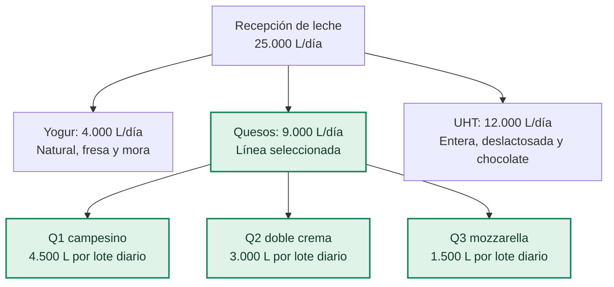

### Justificación técnica de quesos

La selección se sustenta en rutas diferenciadas y recursos compartidos. Campesino requiere lavado, prensado y oreo; doble crema y mozzarella requieren acidificación de cuajada e hilado, con ingredientes y acondicionamiento diferentes.

El VSM identifica el hilado compartido como recurso limitante del escenario inicial. Para aproximadamente 552 kg/día, una tasa de 70 kg/h requiere 7,89 h de proceso; con 30 min de limpieza, 8,39 h frente a una ventana de 7,4 h. La propuesta considera 300 kg/h, equivalentes a 1,84 h de proceso más limpieza. Son **estimaciones del recurso**, no resultados de desempeño de toda la línea.

Esta línea permite relacionar la selección de recetas con la reserva de equipos, las condiciones de proceso y la trazabilidad de producto y suero.

## 5. Distribución y flujo de proceso

La distribución de diseño considera **67 × 30 m**, 22 estaciones y aproximadamente 192,9 m² de huellas de equipos. Las dimensiones de equipos constituyen la base de implantación. El siguiente diagrama representa conexiones funcionales, sin escala geométrica.

```mermaid
flowchart LR
    subgraph zonaLeche ["Zona A–B · Leche"]
        estRecepcion["E01 Recepción y filtro"]
        estSilos["E02 Silos 1 y 2"]
        estEstandarizacion["E03 Descremadora y remezcla"]
        estPasteurizador["E04 Pasteurizador HTST"]
        estRecepcion --> estSilos --> estEstandarizacion --> estPasteurizador
    end
    subgraph zonaTinas ["Zona C · Tinas"]
        estTinaCampesino["E05 Tina 1 · Q1"]
        estTinaDobleCrema["E06 Tina 2 · Q2"]
        estTinaMozzarella["E07 Tina 3 · Q3"]
    end
    subgraph zonaFormado ["Zona D · Formado"]
        estSalado["E08 Salado en masa"]
        estPrensa["E09 Moldeo y prensa"]
        estOreo["E10 Oreo y desmolde"]
        estAcidezDobleCrema["E11 Acidificación Q2"]
        estAcidezMozzarella["E12 Acidificación Q3"]
        estHiladora["E13 Hiladora-moldeadora"]
        estFrioDobleCrema["E14 Enfriamiento Q2"]
        estSalmuera["E15 Agua y salmuera Q3"]
    end
    subgraph zonaEmpaque ["Zona E · Empaque"]
        estTermoformadora["E16 Termoformadora Q1/Q2"]
        estEmpacadoraMozzarella["E17 Empacadora y túnel Q3"]
        estInspeccion["E18 Codificación, peso y metales"]
    end
    subgraph zonaDespacho ["Zona F · Despacho"]
        estEncajado["E19 Encajado"]
        estPaletizado["E20 Paletizado · etapa 3"]
        estCamaraFinal["E21 Cámaras de producto terminado"]
        estCargue["E22 Alistamiento y cargue"]
    end
    estPasteurizador --> estTinaCampesino
    estPasteurizador --> estTinaDobleCrema
    estPasteurizador --> estTinaMozzarella
    estTinaCampesino --> estSalado --> estPrensa --> estOreo --> estTermoformadora
    estTinaDobleCrema --> estAcidezDobleCrema --> estHiladora
    estTinaMozzarella --> estAcidezMozzarella --> estHiladora
    estHiladora --> estFrioDobleCrema --> estTermoformadora
    estHiladora --> estSalmuera --> estEmpacadoraMozzarella
    estTermoformadora --> estInspeccion
    estEmpacadoraMozzarella --> estInspeccion
    estInspeccion --> estEncajado --> estPaletizado --> estCamaraFinal --> estCargue
    classDef campesino fill:#e1f3e7,stroke:#278655,color:#123b2c;
    classDef pastaHilada fill:#fff0df,stroke:#c86b20,color:#60370c;
    classDef compartido fill:#e5eaf8,stroke:#536ba5,color:#1b2c50,stroke-width:2px;
    class estTinaCampesino,estSalado,estPrensa,estOreo campesino;
    class estTinaDobleCrema,estTinaMozzarella,estAcidezDobleCrema,estAcidezMozzarella,estFrioDobleCrema,estSalmuera,estEmpacadoraMozzarella pastaHilada;
    class estHiladora,estTermoformadora,estInspeccion,estEncajado,estPaletizado,estCamaraFinal,estCargue compartido;
```

Los equipos de recepción, silos, tratamiento inicial y servicios se coordinan con la planta. CIP es un servicio auxiliar fuera de la numeración E01–E22. E13 comparte capacidad entre Q2/Q3, E16 entre Q1/Q2 y E20 se plantea como recurso de paletizado compartido por las líneas.

<details>
<summary>Plano de distribución y referencia gráfica de estaciones</summary>


Los planos corresponden a la base de diseño del equipo. La numeración se conserva en los diagramas y las tablas de este documento.

</details>

## 6. Aplicación de ISA-88

### 6.1 Modelo físico

| Nivel | Aplicación |
|---|---|
| Empresa | Lácteos Fúquene S.A.S. |
| Sitio | Planta Ubaté. |
| Área | Fabricación de quesos. |
| Celda de proceso | PC-QUE: campesino Q1, doble crema Q2 y mozzarella Q3. |
| Unidades | Tinas, acidificación, prensa, hilado y acondicionamiento. |
| Módulos de equipo | Carga, dosificación, regulación térmica, agitación/corte y desuerado. |
| Módulos de control | Bomba, válvula, accionamiento de motor, mediciones y lazo térmico. |

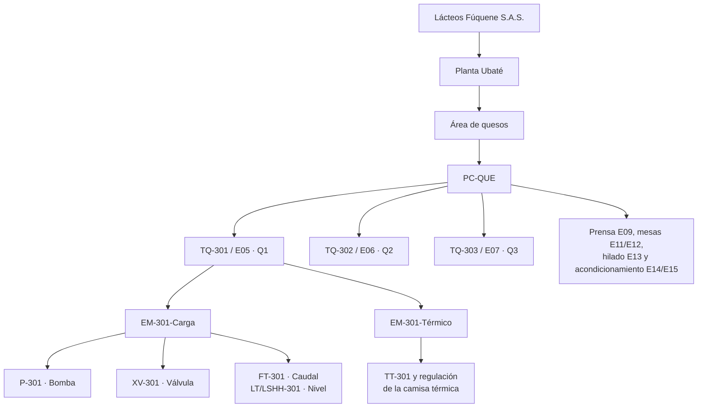

| Unidad / estación | Función | Receta |
|---|---|---|
| TQ-301 / E05 | Tina 1, 5.000 L nominales; lote de 4.500 L. | Q1 |
| TQ-302 / E06 | Tina 2, 5.000 L nominales; lote de 3.000 L. | Q2 |
| TQ-303 / E07 | Tina 3, 5.000 L nominales; lote de 1.500 L. | Q3 |
| PR-305 / E09 | Moldeo y prensado de piezas de 500 g. | Q1 |
| AC-311 / E11 | Acidificación de cuajada; pH de diseño 5,1–5,3. | Q2 |
| AC-312 / E12 | Acidificación de cuajada; pH de diseño 5,1–5,3. | Q3 |
| HI-306 / E13 | Hilado y moldeo; incorporación de crema y sal en Q2. | Q2/Q3 |
| CF-314 / E14 | Enfriamiento de doble crema. | Q2 |
| SA-307 / E15 | Agua fría y salmuera para mozzarella. | Q3 |

IntegraMotion actúa como integradora de la solución; Lácteos Fúquene es la empresa representada en la jerarquía del proceso.

### 6.2 Modelo procedimental

| Nivel | Aplicación a campesino Q1 |
|---|---|
| Procedimiento | Fabricar un lote de campesino. |
| Procedimiento de unidad | Elaborar cuajada en TQ-301. |
| Operación | Preparar leche para coagulación. |
| Fases | Verificar disponibilidad, cargar, ajustar temperatura, dosificar y confirmar adiciones. |

| Producto | Ruta después del tratamiento inicial E01–E04 |
|---|---|
| Q1 | E05: elaboración; E08: salado; E09: moldeo/prensa; E10: oreo; E16: termoformado; E18–E22: inspección y despacho. |
| Q2 | E06: inoculación/coagulación; E11: acidificación; E13: hilado y crema; E14: enfriamiento; E16: termoformado; E18–E22: salida. |
| Q3 | E07: inoculación/coagulación/cocción; E12: acidificación; E13: hilado; E15: agua/salmuera; E17: vacío/encogimiento; E18–E22: salida. |

### 6.3 Recetas y formulación de diseño

Las recetas maestras son **RM-Q1-v3, RM-Q2-v3 y RM-Q3-v3**. La receta de control vincula la versión aprobada con orden, lote, cantidad, equipos y partidas de ingredientes.

Los cultivos se expresan como **cultivo líquido de trabajo**, no como concentrado DVS. El ejemplo de cuajo considera **200 IMCU/mL** y una dosis de diseño de **50 IMCU/L**. Los valores constituyen la base de formulación del proyecto, no una dosis universal para cualquier insumo.

| Ingrediente Q1 | Por 100 L de leche | Lote de 4.500 L |
|---|---:|---:|
| Leche pasteurizada, grasa 2,6 % | 100 L | 4.500 L |
| Cultivo mesófilo de trabajo | 0,50 L | 22,50 L |
| CaCl₂ equivalente | 15 g | 675 g |
| Cuajo, 200 IMCU/mL | 25 mL | 1.125 mL |
| Agua de lavado | 3 L | 135 L |
| Sal sobre cuajada escurrida | 1,5 kg/100 kg de cuajada | 0,015 × masa de cuajada |

| Ingrediente Q2 | Por 100 L de leche | Lote de 3.000 L |
|---|---:|---:|
| Leche entera pasteurizada, grasa 3,6 % | 100 L | 3.000 L |
| Cultivo mesófilo de trabajo, dosis de diseño | 0,50 L | 15 L |
| Cuajo, 200 IMCU/mL | 25 mL | 750 mL |
| Crema pasteurizada, grasa de diseño 40 % | 1 kg | 30 kg |
| Sal sobre cuajada escurrida | 1,5 kg/100 kg de cuajada | 0,015 × masa de cuajada |

| Ingrediente o recurso Q3 | Por 100 L de leche | Lote de 1.500 L |
|---|---:|---:|
| Leche pasteurizada, grasa 2,6 % | 100 L | 1.500 L |
| Cultivo termófilo de trabajo | 1 L | 15 L |
| CaCl₂ equivalente | 10 g | 150 g |
| Cuajo, 200 IMCU/mL | 25 mL | 375 mL |
| Medio de hilado | Agua apta a 75–80 °C | Según carga y equipo |
| Salmuera, concentración de diseño 20 % m/m | 20 kg de sal + 80 kg de agua | Recurso de proceso, no incorporación total al queso |

La asignación de leche indica la carga base; los ingredientes adicionales se contabilizan aparte. La autorización de carga considera capacidad útil, ingredientes y margen de operación. Los balances usan masa y densidad medida para conciliar queso, suero, efluentes y mermas.

### 6.4 Condiciones de proceso

| Receta | Elaboración | Operación diferenciadora | Acondicionamiento |
|---|---|---|---|
| Q1 | Leche 34–35 °C; coagulación 30–40 min; corte 1,5–2 cm. | Lavado, salado, moldeo y prensa 30–60 min; referencia 45 min. | Oreo 4–6 °C, 2–4 h, hasta centro menor de 10 °C; E16. |
| Q2 | Leche 32–34 °C; cultivo hasta acidez 0,20–0,22 %; coagulación 30–40 min. | Acidificación E11 hasta pH 5,1–5,3; referencia 2,5 h; hilado 75–80 °C, crema y sal. | Enfriamiento E14 a 4–6 °C; referencia 6 h; E16. |
| Q3 | Leche 35–37 °C; cultivo termófilo; cocción hasta 38–40 °C. | Acidificación E12 hasta pH 5,1–5,3; referencia 3,5 h; hilado 75–80 °C. | Agua 4–8 °C, 1 h; salmuera 18–20 %, 6–8 h; E17. |

La pasteurización E04 considera 72–75 °C durante 15–20 s. El control supervisa temperatura, caudal y retención. El producto terminado se almacena en E21 a 2–4 °C.

Los tiempos son referencias de programación. El corte exige firmeza confirmada; el hilado exige pH medido y prueba de elasticidad satisfactoria. La temperatura del agua y la de la masa se registran como variables distintas.

### 6.5 Fases, permisos e interbloqueos

| Fase | Condición de inicio | Fin de fase | Respuesta ante fallo |
|---|---|---|---|
| Verificar | Orden y receta autorizadas. | Unidad disponible, limpia y sin CIP activo. | Bloquear inicio si faltan permisos. |
| Cargar | Ruta correcta y capacidad disponible. | Volumen programado alcanzado; bomba detenida y válvula cerrada. | Detener por nivel alto, medición inválida o falta de caudal. |
| Ajustar temperatura | Producto cargado y sensor válido. | Temperatura dentro del intervalo autorizado. | Retener por sensor inválido o sobretemperatura. |
| Dosificar | Temperatura permitida e ingredientes identificados. | Cantidad registrada y adición confirmada. | Bloquear avance sin confirmación. |
| Coagular/cortar | Cuajo registrado y agitación detenida. | Firmeza confirmada antes del corte. | Mantener espera y registrar decisión autorizada. |
| Acidificar/hilar | Cultivo identificado; recurso de hilado reservado. | Acidez/pH de receta y elasticidad aprobados. | Retener ante muestra inválida o condición no satisfactoria. |
| Empacar/liberar | Producto identificado y acondicionado. | Peso, sello y calidad registrados. | Rechazar o retener producto y registrar motivo. |

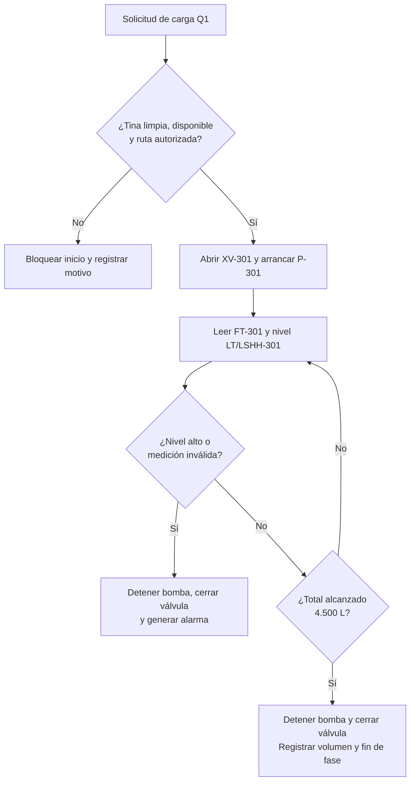

Las confirmaciones manuales, incluida firmeza y prueba de elasticidad, identifican operador, hora y lote. Grafcet, Ladder y las pruebas funcionales desarrollan esta especificación en los módulos de control y gemelo digital.

## 7. Instrumentación propuesta

| Señal o elemento | Función | Decisión asociada |
|---|---|---|
| FT-301 | Totalizar leche cargada en TQ-301. | Finalizar carga al volumen de receta. |
| LT/LSHH-301 | Medir nivel y detectar nivel alto. | Proteger contra sobrellenado. |
| TT-301 | Medir temperatura de tina. | Regular camisa y autorizar fases térmicas. |
| P-301 / XV-301 | Bombear y habilitar entrada. | Ejecutar o detener carga. |
| M-301 | Agitar y cortar. | Seleccionar modo y detener durante coagulación. |
| BAL-01 | Pesar ingredientes y cuajada. | Verificar dosis y calcular sal. |
| pH-M01 | Medición de muestra con equipo calibrado. | Autorizar hilado según pH y elasticidad. |
| Temperatura de E13 | Registrar agua y masa. | Supervisar hilado. |
| Temperatura y concentración de E15 | Supervisar agua fría y salmuera. | Controlar acondicionamiento Q3. |
| Inspección E18 | Peso, codificación y metales. | Rechazo y trazabilidad de empaque. |

Los identificadores de tina se replican para TQ-302 y TQ-303. Cada señal especifica origen físico, entrada manual o variable simulada. Los interbloqueos locales del PLC se conservan ante pérdida de comunicación con gestión.

## 8. Arquitectura de integración ISA-95

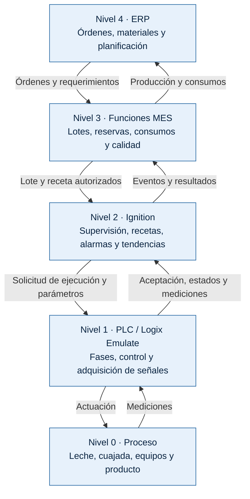

Los niveles indican responsabilidades funcionales. El PLC ejecuta control y secuencias; Ignition constituye la supervisión prevista para el módulo SCADA. Las funciones MES se representan mediante registros estructurados y gestión de lotes; SAP es una referencia conceptual de ERP.

### Interfaces y responsabilidades

| Interfaz | Información | Solución propuesta |
|---|---|---|
| PLC–Ignition | Variables, estados, permisos, comandos y confirmaciones. | Servidor OPC compatible con el controlador; interfaz OPC UA hacia supervisión. |
| Ignition–registro MES | Eventos, consumos, cantidades, paradas y resultados. | Base de datos SQL con identificadores comunes. |
| Gestión–integración | Órdenes y reportes de producción. | API mediante Node-RED. |
| Calidad–gestión | Muestra, ensayo, resultado y liberación/retención. | Registro identificado por lote y responsable. |

Node-RED apoya el intercambio de información. Ignition es el punto de despacho al control; el PLC mantiene la ejecución y los interbloqueos. La arquitectura describe la propuesta, sin afirmar una conexión funcional ya demostrada.

### Recorrido de una orden

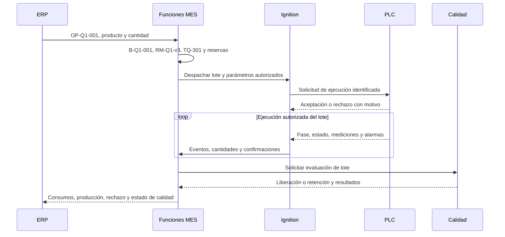

Ejemplo de registro de planificación:

```json
{
  "order_id": "OP-Q1-001",
  "batch_id": "B-Q1-001",
  "product_id": "Q1",
  "recipe_id": "RM-Q1-v3",
  "unit_id": "TQ-301",
  "station_id": "E05",
  "planned_milk_quantity": 4500,
  "quantity_unit": "L"
}
```

Este esquema identifica un ejemplo de orden; no corresponde a una API específica de SAP ni a datos de fabricación real.

### Datos mínimos por lote

| Objeto | Campos principales |
|---|---|
| Orden | Identificador, producto, cantidad/unidad, prioridad y fecha requerida. |
| Receta de control | Versión maestra, lote, equipos, cantidades y partidas asignadas. |
| Evento de fase | Lote, equipo, fase, inicio/fin, valor/unidad y calidad de medición. |
| Consumo | Material, partida, cantidad real, unidad, fase y responsable. |
| Calidad | Muestra, ensayo, resultado, criterio, estado, responsable y hora. |
| Cierre | Producción real, empaque, suero, rechazos, mermas, duración y estado de calidad. |

## 9. Trazabilidad e integridad de la información

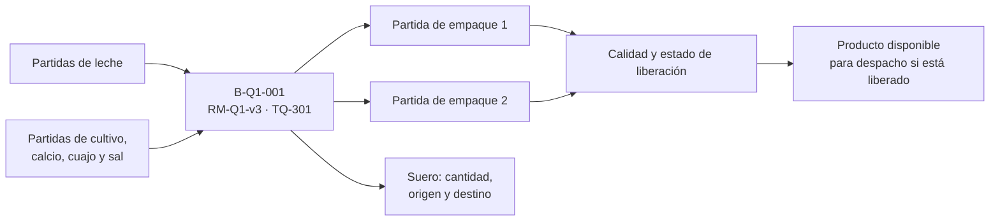

- Las divisiones y mezclas de lotes conservan sus vínculos de origen.
- Cada mensaje lleva identificador único, fecha/hora, origen, lote y versión de esquema.
- Los reintentos evitan duplicar consumos o ejecutar nuevamente una fase.
- Los comandos distinguen solicitud, aceptación, ejecución y finalización.
- La propuesta conserva registros localmente durante desconexión y sincroniza al recuperar el enlace.
- Los permisos distinguen operación, aprobación de recetas, calidad, mantenimiento y programación.

## 10. Articulación con los módulos del proyecto

| Módulo | Relación con el diseño TDI |
|---|---|
| Gestión y evaluación de producción | VSM, capacidades, tiempos y programación con las mismas estaciones y lotes. |
| Controladores industriales | Grafcet y Ladder para las fases, parámetros y permisos definidos. |
| Digital Factory | Gemelo digital detallado de quesos, sensores y actuadores virtuales, ejecución de recetas. |
| SCADA | Ignition, operación y supervisión, alarmas, tendencias y comunicación OPC. |
| Celda robotizada | Paletizado previsto en E20, flujo de cajas y coordinación con producción. |
| Planeación y evaluación de proyectos | Equipos y recursos de la propuesta como base de cronograma y evaluación económica. |

# 11. Simulación de la planta en Tecnomatix Plant Simulation

A continuación se presenta el documento con la estructura de VSM que se tomó como base para la realización de la simulación [Ver Documentación y estructura de vsm](VSM/EDT_proceso_productivo%20(4)-2.pdf)
## 11.1. Objetivo y alcance de la simulación

La simulación de la planta de Lácteos Fúquene S.A.S. se desarrolló en Siemens Tecnomatix Plant Simulation, con el propósito de representar el flujo de materiales, evaluar la utilización de los recursos productivos e identificar posibles restricciones que afecten la continuidad de las operaciones.

El modelo integra las principales estaciones, equipos de procesamiento, tuberías, transportadores, buffers y recursos compartidos definidos para las líneas de queso campesino, queso doble crema y mozzarella. La simulación permite observar los estados operativos de los recursos y analizar cómo la disponibilidad de materia prima, las condiciones de transferencia entre estaciones y la planificación de la producción influyen en el comportamiento del sistema.

El análisis se complementa con la librería BottleneckAnalyzer, utilizada para examinar la distribución temporal de los estados de los recursos e identificar estaciones con altos porcentajes de espera, bloqueo o interrupción.

Los objetivos específicos son:

- Analizar la continuidad del flujo de materiales entre estaciones.
- Identificar recursos con tiempos elevados de espera o bloqueo.
- Examinar las restricciones derivadas de la disponibilidad de materia prima y de la programación de la producción.
- Estimar indicadores de disponibilidad, rendimiento, calidad y OEE para las estaciones seleccionadas.
- Proponer oportunidades de mejora en la coordinación entre equipos y en la planificación de los procesos.

Alcance: los resultados corresponden al comportamiento del modelo bajo los parámetros, tiempos y condiciones de operación configurados. Por tanto, constituyen resultados de simulación y no mediciones directas de una planta industrial en funcionamiento.

## 11.2. Modelado del flujo de producción

El modelo representa el desplazamiento de la materia prima y de las unidades de producción entre los recursos definidos para las líneas de queso. Las estaciones se conectan mediante objetos de transporte y transferencia, mientras que los equipos de procesamiento representan las operaciones correspondientes a cada producto.

Se consideran tres líneas principales:

| Línea | Producto | Producción diaria de referencia |
|---|---|---:|
| Q1 | Queso campesino | 4.500 L/día |
| Q2 | Queso doble crema | 3.000 L/día |
| Q3 | Mozzarella | 1.500 L/día |
| Total | Procesamiento de leche destinado a las tres líneas | 9.000 L/día |

Los volúmenes de la tabla corresponden a la asignación de leche definida para el escenario de producción del proyecto. No representan necesariamente el volumen de producto terminado, puesto que el rendimiento depende de la formulación, la humedad, el desuerado y las características de cada queso.

El modelo incorpora equipos compartidos entre líneas, como los recursos de hilado, moldeo, termoformado y paletizado, cuando corresponde a la configuración definida. Estos recursos requieren especial atención porque pueden introducir dependencias entre las secuencias de producción y limitar la capacidad de procesamiento si varias líneas los requieren simultáneamente.

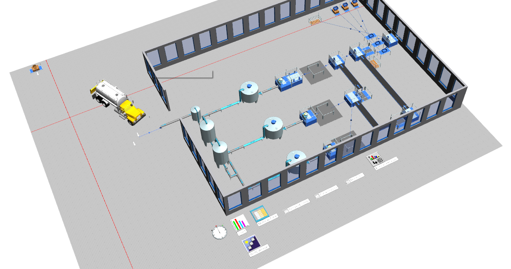

*Figura 11.1. Representación general del sistema productivo y de las conexiones entre recursos.*

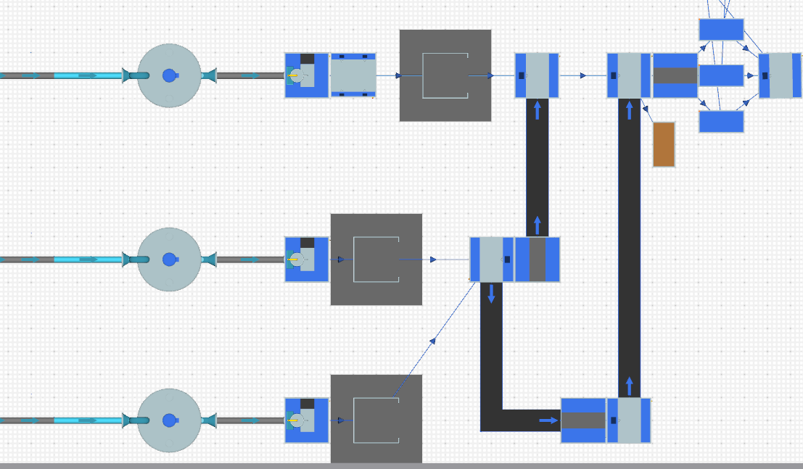

*Figura 11.2. Flujo de materiales y equipos compartidos entre las líneas de producción.*

## 11.3. Condiciones de operación y supuestos de simulación

La evaluación se realiza bajo las condiciones temporales y de suministro configuradas en el modelo. Para interpretar correctamente los resultados, se diferencia entre el horizonte total de simulación, el tiempo programado para producir y los periodos en los que la operación no está prevista.

La disponibilidad de materia prima no se considera necesariamente continua durante todo el horizonte. En particular, para la línea Q3 se contempla una ventana efectiva de producción determinada por la planificación de turnos, la asignación diaria de leche y la demanda del producto.

Los siguientes criterios se utilizan para interpretar los resultados:

| Parámetro | Criterio adoptado |
|---|---|
| Horizonte de simulación | Periodo total configurado en Tecnomatix Plant Simulation |
| Programación de turnos | Determina los intervalos en los que se requiere producción |
| Disponibilidad de materia prima | Depende de la asignación y del suministro definidos para cada línea |
| Demanda de producción | Determina la cantidad de producto que se necesita fabricar |
| Calidad | Se adopta un valor del 97 % como supuesto de modelado para el cálculo ilustrativo del OEE |
| Análisis de estados | Se utiliza BottleneckAnalyzer para evaluar la distribución temporal de los estados de los recursos |

El porcentaje del 97 % de calidad es un supuesto y no una medición de producto conforme obtenida de la simulación. Para calcular un OEE industrial validado, este valor deberá sustituirse por la proporción real o simulada de unidades conformes respecto del total producido.

## 11.4. Análisis de estados mediante BottleneckAnalyzer

La librería BottleneckAnalyzer permite examinar el porcentaje de tiempo que cada recurso permanece en los diferentes estados registrados durante la simulación. Esta información facilita la identificación de estaciones que trabajan durante una parte reducida del horizonte, permanecen esperando material o se encuentran bloqueadas por restricciones en el flujo.

Los principales estados considerados son:

| Estado | Interpretación |
|---|---|
| `Working` | El recurso ejecuta su operación productiva. |
| `Set-up` | El recurso realiza actividades de preparación o cambio de configuración. |
| `Waiting` | El recurso permanece esperando una entidad, material, condición o evento necesario para continuar. |
| `Blocked` | El recurso no puede transferir o liberar el material debido a una restricción aguas abajo o a una condición de salida. |
| `PoweringUpDown` | El recurso está en una transición de encendido o apagado. |
| `Disrupted` | El recurso se encuentra en un estado de interrupción definido por el modelo. |
| `Stopped` | El recurso está detenido según la lógica configurada. |
| `Pause` | El recurso se encuentra en un periodo de pausa definido en el modelo. |

La interpretación de estos estados depende de la lógica implementada en cada objeto. Por ejemplo, `Waiting` no representa necesariamente una falla ni una pérdida de eficiencia: puede corresponder a una espera normal por disponibilidad de materia prima o a una operación que todavía no necesita ejecutarse.

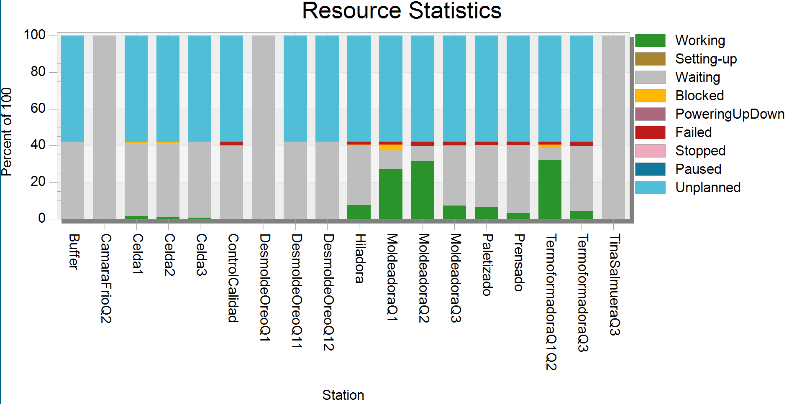

*Figura 11.2. Estadísticas de cada máquina.*

### 11.4.1. Interpretación de las restricciones

#### a. Bloqueo en `DePortioner11`

El recurso presenta un 80,86 % de tiempo de trabajo y un 19,14 % de tiempo bloqueado. Este comportamiento indica que, durante una parte del horizonte, el equipo no puede continuar con normalidad debido a una restricción de salida o a la lógica de transferencia configurada.

Para determinar si el bloqueo está relacionado con la capacidad de la estación siguiente, el espacio disponible en un buffer o una condición de transferencia, es necesario revisar la conexión entre los objetos y los eventos ocurridos durante esos intervalos.

#### b. Espera en `TinaQuesoCampesino`

La tina registra un 80,86 % de espera y un 19,14 % de interrupción, sin tiempo de trabajo en la salida analizada. Este resultado indica que el recurso no está ejecutando la operación productiva durante el horizonte observado.

El patrón podría estar relacionado con la disponibilidad de entidades de entrada, la programación de la operación o las condiciones de activación del equipo. Sin embargo, el resultado no permite atribuir por sí solo la espera a una causa física específica. Se debe verificar si la tina recibe material, si los tiempos de proceso están correctamente configurados y si la lógica de inicio e interrupción corresponde a la secuencia productiva prevista.


## 11.5. Cálculo e interpretación del OEE

El indicador OEE (*Overall Equipment Effectiveness*) permite evaluar el desempeño de un equipo a partir de tres componentes: disponibilidad, rendimiento y calidad.

La expresión general es:

\[
OEE = D \times R \times C
\]

donde:

- \(D\): disponibilidad.
- \(R\): rendimiento.
- \(C\): calidad.

Para el análisis presentado se utilizan las siguientes expresiones:

\[
D = \frac{T_p-T_d}{T_p}\times100
\]

\[
R = \frac{T_w}{T_p-T_d}\times100
\]

donde:

- \(T_p\): tiempo programado de producción.
- \(T_d\): tiempo en estado `Disrupted` dentro de la ventana programada.
- \(T_w\): tiempo en estado `Working` dentro de la ventana programada.

Para combinar los tres componentes en la expresión del OEE, los porcentajes se convierten a valores entre 0 y 1. En esta estimación, el rendimiento se aproxima mediante la fracción de tiempo en estado `Working` respecto del tiempo programado disponible después de descontar `Disrupted`. Este procedimiento es una aproximación basada en estados del modelo; no sustituye el cálculo convencional del rendimiento a partir del tiempo de ciclo ideal y las unidades producidas.

### 11.5.1. Resultados de referencia para las moldeadoras

Los resultados previamente obtenidos para las moldeadoras son los siguientes:

| Indicador | Q1: MoldeadoraQ1 | Q2: MoldeadoraQ2 | Q3: MoldeadoraQ3 |
|---|---:|---:|---:|
| Tiempo programado utilizado, \(T_p\) | 43,75 % | 43,75 % | 14,00 % |
| Disponibilidad, \(D\) | 97,53 % | 93,76 % | 80,86 % |
| Rendimiento estimado, \(R\) | 70,82 % | 78,60 % | 74,73 % |
| Calidad asumida, \(C\) | 97,00 % | 97,00 % | 97,00 % |
| OEE estimado | 67,00 % | 71,49 % | 58,62 % |

*Nota: estos resultados provienen del análisis previo de las moldeadoras y utilizan ventanas de tiempo programado específicas. Deben conservarse únicamente si corresponden a la misma configuración, ejecución y definición de estados de la simulación. La tabla de BottleneckAnalyzer presentada en la sección 11.4 muestra una distribución diferente para `MoldeadoraQ1`, `MoldeadoraQ2` y `MoldeadoraQ3` (100 % en espera), por lo que es necesario verificar que ambas salidas correspondan a la misma corrida y al mismo intervalo antes de presentarlas como resultados directamente comparables.*

### 11.5.2. Justificación del tiempo programado de Q3

Para la línea Q3, correspondiente a mozzarella, se adoptó un tiempo programado de producción equivalente al 14 % del horizonte total de simulación.

Este valor se definió a partir del análisis del comportamiento de los recursos mediante la librería BottleneckAnalyzer y de la planificación operativa establecida para el escenario. En particular, se consideraron los turnos de producción, la asignación diaria de materia prima, el carácter no continuo del suministro de leche y la cantidad de mozzarella requerida de acuerdo con la demanda.

A diferencia de un escenario de abastecimiento continuo, la línea Q3 no necesita permanecer produciendo durante todo el horizonte de simulación. Su operación se concentra en una ventana durante la cual existe materia prima disponible para fabricar la cantidad planificada. Una vez satisfecha la necesidad de producción o agotada la asignación de leche destinada a la línea, la operación se detiene porque no se requiere continuar procesando material durante el resto del periodo analizado.

Por esta razón, el tiempo restante se considera fuera del tiempo programado de producción únicamente bajo el supuesto de que la línea no tenía obligación de producir durante esos intervalos. Esta decisión evita contabilizar como pérdida operativa el tiempo en el que la producción no está planificada debido a la demanda y al esquema de suministro definido.

El 14 % constituye, por tanto, un criterio de planificación del modelo sustentado en el análisis de estados y en las condiciones de suministro y demanda, y no una medición directa del tiempo de operación. Para documentar adecuadamente esta decisión, se recomienda conservar como evidencia la salida de BottleneckAnalyzer, la programación de turnos y la asignación de materia prima a Q3.

La distinción es importante: si la estación estuviera programada para producir y no pudiera hacerlo por falta de leche, esa situación debería evaluarse como una pérdida de disponibilidad. En cambio, si el periodo se encuentra formalmente fuera del programa de producción, no debe incorporarse al denominador del OEE.

### 11.5.3. Interpretación comparativa

De acuerdo con los resultados de referencia de la sección 11.5.1, Q2 presenta el OEE estimado más alto, con 71,49 %, seguida de Q1, con 67,00 %. Q3 registra 58,62 % cuando se evalúa exclusivamente dentro de la ventana programada del 14 % del horizonte.

Estas diferencias deben interpretarse teniendo en cuenta que Q3 utiliza un denominador temporal distinto. Por ello, el OEE de Q3 no debe compararse de forma aislada con los de Q1 y Q2 sin verificar que las ventanas programadas, los criterios de clasificación de estados y las condiciones de operación sean consistentes.

Además, el porcentaje de calidad del 97 % es un supuesto de cálculo. Para obtener un OEE más representativo, se deberán incorporar el tiempo de ciclo ideal, las cantidades producidas y las unidades conformes de cada línea.

## 11.6. Oportunidades de mejora identificadas

A partir de los resultados de estados y del cálculo de indicadores, se proponen las siguientes acciones:

| Hallazgo | Acción recomendada | Objetivo |
|---|---|---|
| Bloqueo de `DePortioner11` | Revisar la capacidad de salida, las conexiones y las condiciones de transferencia. | Reducir bloqueos y mejorar la continuidad del flujo. |
| Espera elevada en `TinaQuesoCampesino` | Verificar las llegadas de material, los tiempos de proceso y la lógica de activación. | Determinar si la espera es normal o se debe a una restricción del modelo. |
| Baja utilización de `Track` | Revisar el ritmo de llegada de entidades y la sincronización con los recursos conectados. | Evitar esperas innecesarias y mejorar la coordinación del transporte. |
| Recursos con 100 % de espera o bloqueo | Comprobar la conectividad, las condiciones de liberación y la generación de entidades en cada línea. | Confirmar que todas las estaciones estén correctamente representadas. |
| Suministro no continuo de leche a Q3 | Alinear el tiempo programado con los turnos, la asignación de materia prima y la demanda. | Evaluar el desempeño dentro de la ventana real de producción prevista. |
| Calidad fijada en 97 % | Incorporar datos de unidades conformes y no conformes. | Obtener una estimación de calidad sustentada en datos del proceso. |
| Rendimiento calculado mediante estados | Incorporar el tiempo de ciclo ideal y la cantidad producida. | Aproximar el OEE al método convencional de cálculo. |

Estas acciones deben evaluarse mediante nuevas corridas de simulación y comparación de escenarios. No se considera suficiente aumentar la capacidad de un equipo únicamente porque registre una utilización elevada: también debe verificarse si la estación limita realmente la producción total del sistema.

## 11.7. Limitaciones del análisis

Los resultados están condicionados por los parámetros de entrada, la lógica de los objetos y el horizonte de simulación utilizado. Por ello, se reconocen las siguientes limitaciones:

1. Los estados de BottleneckAnalyzer describen la distribución temporal de los recursos, pero no identifican por sí solos la causa física de cada espera, bloqueo o interrupción.
2. Los recursos con 100 % de espera o bloqueo deben verificarse antes de interpretar sus resultados como evidencia de restricciones industriales.
3. El 14 % de tiempo programado para Q3 es un criterio adoptado para representar la ventana efectiva de producción del escenario; su trazabilidad depende de la planificación de turnos, la asignación de leche y la demanda.
4. La calidad del 97 % corresponde a un supuesto de modelado y no a un resultado medido de conformidad.
5. El rendimiento estimado a partir del estado `Working` es una aproximación temporal y no equivale necesariamente al rendimiento convencional calculado mediante el ciclo ideal.
6. Los resultados de OEE y BottleneckAnalyzer deben corresponder a la misma configuración y corrida de simulación, o sus diferencias deben explicarse expresamente.

# 12. Caso de estudio, producción y evaluación financiera

## 12.1. Documentos

| Documento | Contenido |
|---|---|
| [Documento del caso](Produccion%20y%20finanzas/Documento_del_caso.pdf) | Lácteos Fúquene (operación, estados financieros, hallazgos), entorno del sector, normas que condicionan el proyecto, IntegraMotion (constitución, normas, cómo y cuánto cobra), matriz de selección de la línea y alcance preliminar de la oferta. |
| [EDT del proceso productivo](Produccion%20y%20finanzas/EDT_proceso_productivo.pdf) | Desglose de las operaciones de las tres líneas, nivel de automatización actual y propuesto para la quesería, recursos y cuellos de botella. |
| [VSM de las líneas](Produccion%20y%20finanzas/VSM_lineas.pdf) | Mapas de flujo de valor del campesino, los hilados, el yogur y el UHT; recursos compartidos, OEE de los equipos de fin de línea e indicadores por familia. |
| [Modelo financiero de la quesería](Produccion%20y%20finanzas/Modelo_financiero_queseria.xlsx) | Inversión, beneficios, flujo de caja a 10 años, financiación, escenarios y modelo de negocio de IntegraMotion. |

## 12.2. Oferta para la quesería

La propuesta se ejecuta por etapas: diagnóstico de la planta (etapa 0); tinas automatizadas, medición de grasa en línea y SCADA, historiador y MES ligero de la quesería (etapa 1); hiladora-moldeadora continua, CIP del circuito de quesos y aprovechamiento del suero (etapa 2). La celda robotizada de paletizado queda como trabajo planeado. La oferta incluye el diseño de la interfaz con el ERP; la configuración del ERP y la ampliación a yogur y UHT no hacen parte de ella.

Cifras en millones de pesos constantes, tasa de descuento del 16 %:

| Indicador | Valor |
|---|---:|
| Inversión (años 0 y 1) | 1.039 |
| Beneficio anual en régimen | 369 |
| TIR del proyecto | 18,5 % |
| VPN | 92 |
| ROI a 10 años | 128 % |
| Recuperación | 5,0 años |
| TIR del inversionista (70 % financiado, 7 años, 14,1 % E.A.) | 31,1 % |

La inversión se financia con la línea Impulso a la Productividad de Bancóldex. Ningún trabajador sale de la empresa: los operarios del hilado se capacitan y se reasignan. Los escenarios de riesgo y los supuestos están en el documento del caso y en el modelo financiero.
